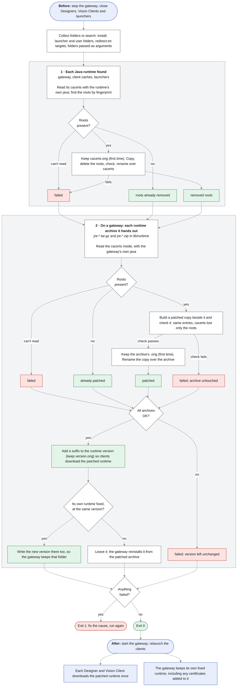

# Protecting Ignition from the compromised eMudhra intermediate CAs

These scripts protect the Java runtimes bundled with Ignition against the compromised eMudhra intermediate CAs. They remove eMudhra's root certificates and Sectigo's AAA Certificate Services root from each runtime's trust store. Download them from the [latest release](../../releases/latest): its Windows script is signed by Inductive Automation, LLC, while the copy in this repository is unsigned.

## What happened

On 17 October 2026, researchers reported that the private keys of eight eMudhra intermediate CA certificates were compromised. An attacker holding one of these keys can create a certificate for any server name. Current web browsers and up-to-date operating systems already block the certificates.

The Java runtime bundled with Ignition still trusts them, both through eMudhra's own emSign root and through Sectigo cross-signed copies of the intermediates that chain to the "AAA Certificate Services" root. Java does not check certificate revocation by default, so the CA's revocation of these certificates has no effect on Ignition. Current Java releases do not block them yet.

Blocking the compromised certificates by fingerprint isn't enough. An attacker holding one of these keys can re-encode the intermediate certificate so that its fingerprint changes, and Java still trusts it. Oracle's guidance at https://ops.java/emudhra is to remove four root certificates from Java's trust store: the two the intermediates chain to, and eMudhra's emSign Root CA - G1 and G2.

## Who is affected

Every Ignition Java runtime is affected:

| Component | Runtime location |
|---|---|
| Gateway | `<Ignition install>/lib/runtime/jre-*/` |
| Designer and Vision Client | A per-user copy downloaded from each gateway, under `~/.ignition/cache/resources/runtimes/<version>/` |
| Designer Launcher, Vision Client Launcher, Workstation | The Java runtime inside each launcher's install folder: `jre` on Windows, `runtime` on Linux, and `Contents/Resources/runtime` inside the app on macOS |

A compromised certificate could let an attacker impersonate any HTTPS server the gateway or a client connects to. That includes another Ignition gateway, an identity provider, a mail server, or any web API called from scripts.

## The fix: remove the eMudhra roots and AAA Certificate Services

Java keeps its trusted root certificates in `lib/security/cacerts` inside every runtime. The fix removes the four roots Oracle lists: emSign ECC Root CA - G3 and AAA Certificate Services, which the compromised intermediates chain to, and emSign Root CA - G1 and emSign Root CA - G2. It also removes eMudhra's two other roots, emSign Root CA - C1 and emSign ECC Root CA - C3, which only runtimes from older Ignition releases include. Those older runtimes don't include emSign Root CA - G2. The fix works for every Ignition version (Java 11, 17, 21 and 25).

**Side effects:** removing these roots stops the runtime from trusting any server whose certificate chains only to one of them, including certificates eMudhra issued under its emSign roots. Before you apply the fix, check the HTTPS services your gateways and clients connect to, and watch for certificate errors afterward. In our testing, common sites, including ones using Sectigo certificates, kept working.

**macOS launchers:** changing a launcher's runtime breaks the app's code signature. Open each launcher at least once before you apply the fix, so macOS completes its first-launch check. If the fix is applied to a launcher that has never been opened, macOS reports it as damaged and won't open it; move it to the Trash, reinstall it, open it once, and apply the fix again. A changed launcher keeps working on that Mac, but don't copy it to another Mac. Install the launcher there and apply the fix on that Mac instead.

### Option A: run the script (recommended)

1. Download the script for your operating system from the [latest release](../../releases/latest): `remove-emudhra-roots.ps1` for Windows, or `remove-emudhra-roots.sh` for Linux and macOS.
2. On Windows, check the script's signature:
   ```powershell
   Get-AuthenticodeSignature .\remove-emudhra-roots.ps1 | Format-List Status, SignerCertificate
   ```
   `Status` should be `Valid`, and the signer `CN=Inductive Automation, LLC`. If it shows anything else, don't run it: download it again, and email ignition-security@inductiveautomation.com if the result stays the same. Don't open and save the script in an editor: any change, even to its line endings, breaks the signature.
3. Stop the Ignition gateway service, and close any running Designer, Vision Client and launcher windows.
4. Run the script.
   - **Windows**, from an elevated PowerShell:
     ```powershell
     powershell -ExecutionPolicy Bypass -File .\remove-emudhra-roots.ps1
     ```
     Because the script is signed, it also runs where Group Policy sets the execution policy, which `-ExecutionPolicy Bypass` can't override. Under `AllSigned`, PowerShell first asks whether to run software from Inductive Automation, LLC: answer `R` to run it once, or `A` to always trust this publisher.
   - **Linux and macOS:**
     ```sh
     sudo sh ./remove-emudhra-roots.sh
     ```

   If Ignition or a launcher is installed in a non-default folder, add that folder to the end of the command, for example `powershell -ExecutionPolicy Bypass -File .\remove-emudhra-roots.ps1 D:\Ignition` on Windows or `sudo sh ./remove-emudhra-roots.sh /opt/ignition` on Linux. On Linux, the launchers have no standard install folder, so always add the folder you extracted each launcher into.
5. Start the Ignition gateway service. The fix doesn't take effect until you do: the gateway reads the runtime version it gives clients, and its own Java loads its trust store, only when it starts.
6. Relaunch the Designer and Vision Clients.

The script finds every Ignition runtime on the machine. In each one, it removes these roots from `cacerts`, saving the original as `cacerts.orig`. It finds the roots by their fingerprints, so it also works on runtimes that store them under other names. It is safe to run more than once.

On a gateway, the script also fixes the runtimes the gateway hands out to Designers and Vision Clients, which are the `jre-*.tar.gz` and `jre-*.zip` files in `lib/runtime`: it removes the roots from each one. It then adds a suffix to the runtime version in `lib/runtime/version`, so once the gateway starts again, every Designer and Vision Client downloads the fixed runtime the next time it launches. Each download is about 45 MB. It writes the same version into the gateway's own runtime folder, which it has already fixed, so the gateway keeps that folder instead of reinstalling it from the archive. The original files are kept with a `.orig` extension.

If you can't take the gateway down for the whole run, you can run the script while it runs and restart it afterward, so the only downtime is the restart. The script changes each file in a copy and then renames the copy over the original, so nothing reads a half-written file. On Windows, a runtime archive that a client is downloading at that moment can be reported as failed; run the script again.

- **Linux gateways** need the `zip` and `unzip` commands to fix the Windows runtime. Install them before running the script. macOS includes them.
- **If the script couldn't fix the gateway's own runtime,** or the gateway was upgraded and hasn't started since, the script prints a `left for the gateway to reinstall` line. The gateway then reinstalls that runtime from the fixed archive when it starts. A reinstall drops any change made inside the runtime folder, such as certificates added to its `cacerts` file, so make those changes again once the gateway is running.

If the script prints a `failed:` line, it couldn't change that file, and the line shows why. Fix the cause and run the script again, or apply the fix by hand as in Option B. If the script couldn't fix every runtime a gateway hands out, it leaves that gateway's runtime version unchanged.

Run the script on every gateway, and on every workstation that runs a launcher or Workstation. Designers and Vision Clients don't need the script once their gateway has been fixed with it and restarted.

### Option B: apply the fix by hand

Stop the gateway and close the clients first. Do the following in each runtime folder listed below, then start the gateway and relaunch the clients.

1. Back up `lib/security/cacerts`.
2. Remove the roots with the runtime's own `keytool`, where `<runtime>` is the runtime folder. Always give its full path, even from inside the runtime's `bin` folder: a bare `keytool` runs whichever Java is on the system path, and `-cacerts` then changes that Java's trust store instead of Ignition's.
   - Windows (PowerShell):
     ```powershell
     & "<runtime>\bin\keytool.exe" -delete -cacerts -alias "emsignrootcag1 [jdk]" -storepass changeit
     & "<runtime>\bin\keytool.exe" -delete -cacerts -alias "emsignrootcag2 [jdk]" -storepass changeit
     & "<runtime>\bin\keytool.exe" -delete -cacerts -alias "emsigneccrootcag3 [jdk]" -storepass changeit
     & "<runtime>\bin\keytool.exe" -delete -cacerts -alias "comodoaaaca [jdk]" -storepass changeit
     ```
   - Linux and macOS:
     ```sh
     "<runtime>/bin/keytool" -delete -cacerts -alias "emsignrootcag1 [jdk]" -storepass changeit
     "<runtime>/bin/keytool" -delete -cacerts -alias "emsignrootcag2 [jdk]" -storepass changeit
     "<runtime>/bin/keytool" -delete -cacerts -alias "emsigneccrootcag3 [jdk]" -storepass changeit
     "<runtime>/bin/keytool" -delete -cacerts -alias "comodoaaaca [jdk]" -storepass changeit
     ```
     `keytool` isn't always marked executable: it never is in a Designer or Vision Client runtime, and on some Linux gateways it isn't either. If running it reports "Permission denied", use `"<runtime>/bin/java" -m java.base/sun.security.tools.keytool.Main` in place of `"<runtime>/bin/keytool"`, here and below, or make it executable first with `chmod +x "<runtime>/bin/keytool"`.

   Then list any of these roots still in the runtime, and delete each one listed the same way. Runtimes from older Ignition releases store some of them under other names, so a delete above can report that an alias doesn't exist, and they also include emSign Root CA - C1 and emSign ECC Root CA - C3. Once all are gone, the list is empty.
   - Windows (PowerShell): `& "<runtime>\bin\keytool.exe" -list -v -cacerts -storepass changeit | Select-String "Owner: CN=(emSign Root CA - (G1|G2|C1)|emSign ECC Root CA - (G3|C3)|AAA Certificate Services)," -Context 5,0`
   - Linux and macOS: `"<runtime>/bin/keytool" -list -v -cacerts -storepass changeit | grep -B 5 -E "Owner: CN=(emSign Root CA - (G1|G2|C1)|emSign ECC Root CA - (G3|C3)|AAA Certificate Services)," | grep "Alias name"`

These steps don't change the runtimes a gateway hands out, so Designers and Vision Clients need the fix again whenever they download a runtime (see [When to repeat these steps](#when-to-repeat-these-steps)).

**Gateway**
- Windows: `C:\Program Files\Inductive Automation\Ignition\lib\runtime\jre-win`
- Linux: `/usr/local/bin/ignition/lib/runtime/jre-*`
- macOS: `/usr/local/ignition/lib/runtime/jre-mac`

**Designer and Vision Client runtimes, one folder per gateway version, for every user**
- Windows: `C:\Users\<user>\.ignition\cache\resources\runtimes\<version>`
- Linux and macOS: `~/.ignition/cache/resources/runtimes/<version>`
- If the user's `.ignition` folder contains a `redirect.txt` file: `<folder on its first line>/cache/resources/runtimes/<version>`

**Launchers**
- Windows: `C:\Program Files\Inductive Automation\<Launcher name>\jre`, or under `C:\Users\<user>\AppData\Roaming\Inductive Automation\` for a per-user install
- macOS: `/Applications/<Launcher name>.app/Contents/Resources/runtime`
- Linux: `<folder you extracted the launcher into>/runtime`

A gateway configured to use its own trust store, for example with `-Djavax.net.ssl.trustStore` in `ignition.conf`, needs these roots removed from that trust store too.

### Gateways running in Docker

Changes made to files inside a container are lost when the container is recreated from its image, for example on an upgrade. Instead, make a copy of the image's `cacerts` without these roots, and mount it over the runtime's copy. Use the same image version you run:

```sh
docker run --rm --entrypoint sh inductiveautomation/ignition:<version> -c 'cat /usr/local/bin/ignition/lib/runtime/jre/lib/security/cacerts' > cacerts
docker run --rm -u "$(id -u):$(id -g)" -v "$PWD:/w" --entrypoint /usr/local/bin/ignition/lib/runtime/jre/bin/keytool inductiveautomation/ignition:<version> -delete -keystore /w/cacerts -storepass changeit -alias "emsignrootcag1 [jdk]"
docker run --rm -u "$(id -u):$(id -g)" -v "$PWD:/w" --entrypoint /usr/local/bin/ignition/lib/runtime/jre/bin/keytool inductiveautomation/ignition:<version> -delete -keystore /w/cacerts -storepass changeit -alias "emsignrootcag2 [jdk]"
docker run --rm -u "$(id -u):$(id -g)" -v "$PWD:/w" --entrypoint /usr/local/bin/ignition/lib/runtime/jre/bin/keytool inductiveautomation/ignition:<version> -delete -keystore /w/cacerts -storepass changeit -alias "emsigneccrootcag3 [jdk]"
docker run --rm -u "$(id -u):$(id -g)" -v "$PWD:/w" --entrypoint /usr/local/bin/ignition/lib/runtime/jre/bin/keytool inductiveautomation/ignition:<version> -delete -keystore /w/cacerts -storepass changeit -alias "comodoaaaca [jdk]"
```

Then list any of these roots still in the copy, and delete each one listed the same way. Images of older releases store some of them under other names, so a delete above can report that an alias doesn't exist, and they also include emSign Root CA - C1 and emSign ECC Root CA - C3. Once all are gone, the list is empty:

```sh
docker run --rm -v "$PWD:/w" --entrypoint /usr/local/bin/ignition/lib/runtime/jre/bin/keytool inductiveautomation/ignition:<version> -list -v -keystore /w/cacerts -storepass changeit | grep -B 5 -E "Owner: CN=(emSign Root CA - (G1|G2|C1)|emSign ECC Root CA - (G3|C3)|AAA Certificate Services)," | grep "Alias name"
```

Then recreate the gateway container with the copy mounted:

```sh
docker run ... \
  -v /path/to/cacerts:/usr/local/bin/ignition/lib/runtime/jre/lib/security/cacerts:ro \
  inductiveautomation/ignition:<version>
```

With Docker Compose, add the same mount to the gateway service's `volumes:` and run `docker compose up -d`. Make a new `cacerts` copy whenever you change the image version, and remove the mount once you upgrade to an Ignition release whose bundled Java includes the fix.

These commands are for images of Ignition 8.1.15 and later. Images of 8.1.14 and earlier unpack the runtime when the container starts, so for those, run the script inside the running container instead, then restart it. The first command installs `zip` and `unzip`, which the script needs to fix the Windows runtime the gateway hands out. Do this again whenever the container is recreated:

```sh
docker exec -u root <container> sh -c 'apt-get update && apt-get install -y zip unzip'
docker cp remove-emudhra-roots.sh <container>:/tmp/
docker exec -u root <container> sh /tmp/remove-emudhra-roots.sh
docker restart <container>
```

The mount covers only the gateway's own runtime, so Designers and Vision Clients need the fix again whenever they download a runtime from it (see [When to repeat these steps](#when-to-repeat-these-steps)).

## Check that it worked

Open the Designer's Script Console and run:

```python
system.net.httpClient().get("https://dv-g3b-emudhra.we-have-a-problem.com/")
```

A certificate or `SSLHandshakeException` error means the runtime is protected. A response means it is not. This tests the Designer's runtime. To test the gateway, run the same line once from a gateway-scoped script, such as a temporary Gateway Timer Script, and check the gateway logs.

To confirm a Designer is running the fixed runtime, run this in its Script Console:

```python
from java.lang import System
print(System.getProperty("java.home"))
```

On a gateway fixed with the script, the runtime folder's name contains `.20261028`, for example `.../runtimes/17.0.20.1.20261028.aarch64`. Without it, the gateway hasn't been restarted since the script ran, or the Designer hasn't been relaunched.

## When to repeat these steps

- **After upgrading the gateway:** the upgrade replaces the gateway's runtime, including `cacerts`, the runtimes it hands out, and the runtime version.
- **On a workstation, whenever the Designer or a Vision Client downloads a new runtime from a gateway that wasn't fixed with the script,** for example one fixed by hand or with the Docker mounts. That happens on a new workstation, for a new user, after the cache is cleared, or after a gateway upgrade.
- **After upgrading or reinstalling a launcher.**

You can stop repeating these steps once you install an Ignition release whose bundled Java includes the fix. We will announce which release that is.

## Undo

Rename each `.orig` file back to its original name: `cacerts.orig` in each runtime's `lib/security` folder, and on a gateway, the `jre-*.tar.gz.orig`, `jre-*.zip.orig` and `version.orig` files in `lib/runtime` and the `version.orig` file in the gateway's own runtime folder, such as `lib/runtime/jre-win`. Then restart the gateway and relaunch the clients. If the gateway reinstalled its own runtime instead, that folder has no `.orig` files; restoring the files in `lib/runtime` makes Linux and macOS gateways reinstall the original runtime when they next start.

## Why not use a CRL or OCSP?

Oracle's guidance offers turning on online revocation checking as an alternative to removing the roots (`com.sun.net.ssl.checkRevocation=true` with `com.sun.security.enableCRLDP=true`, or `ocsp.enable=true`). Java has no setting that loads a CRL file from disk, so with revocation checking on, every connection fails when the gateway or client cannot reach the CA's CRL or OCSP server. Connections to devices and servers that use certificates without revocation information also fail. We do not recommend it.

## Can clients use the operating system's trust store instead?

On Windows and Linux workstations where you manage the operating system's trusted root certificates, for example through Group Policy, this is an alternative to running the script on each workstation. Set `"trust.store": "system"` in each launcher's configuration file. The launcher, and the Designers and Vision Clients it starts, then trust the operating system's root certificates instead of Java's.

Java still checks certificates itself and doesn't read the operating system's list of blocked certificates, so blocking the compromised intermediates there has no effect. Instead, remove the root certificates they chain to from the operating system's trusted roots, if present: emSign ECC Root CA - G3, emSign Root TLS CA - G3, and AAA Certificate Services, along with emSign Root CA - G1, G2 and C1 and emSign ECC Root CA - C3, which the fix also removes. This also removes trust from everything else issued under those roots. On Windows, also turn off Automatic Root Certificates Update, or Windows can add them back.

- The setting doesn't affect the gateway, so still run the script there.
- It isn't an option on macOS, where clients would stop connecting to most public HTTPS servers.
- With this setting, the launcher can't accept a gateway's certificate itself. A gateway with a self-signed certificate needs that certificate added to the operating system's trusted roots.

## How the scripts work

Both scripts follow the same steps. Each change is made in a copy, which is then renamed over the original, so nothing ever reads a half-written file. The first change to each file keeps the original next to it with a `.orig` extension. A runtime that can't be changed is reported on a `failed:` line, and the script moves on to the next one.



Green boxes are results, red boxes are failures, and blue boxes are steps for whoever runs the script.

## License

MIT. See [LICENSE](LICENSE).
